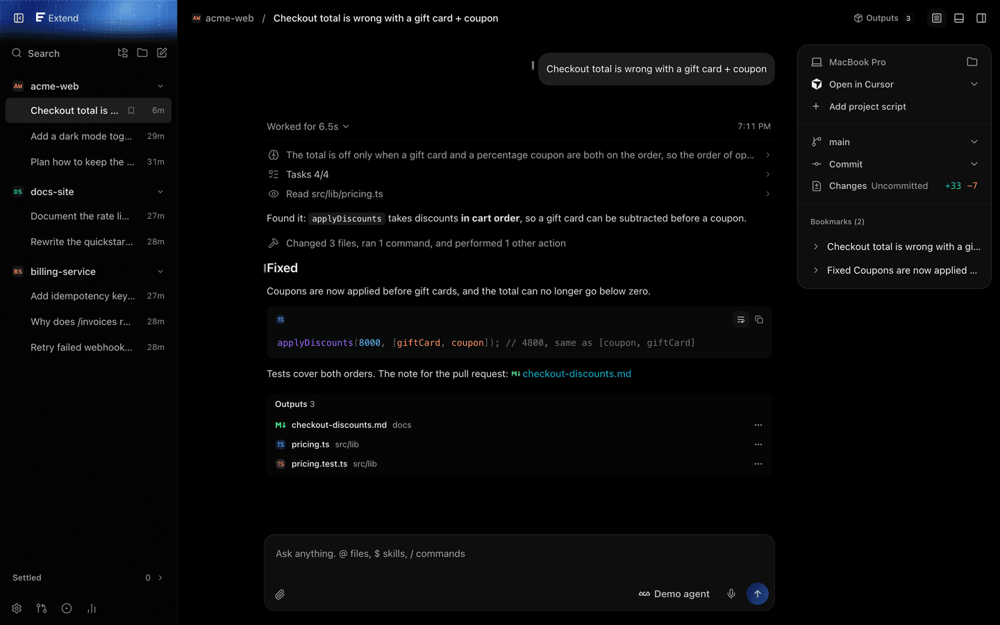
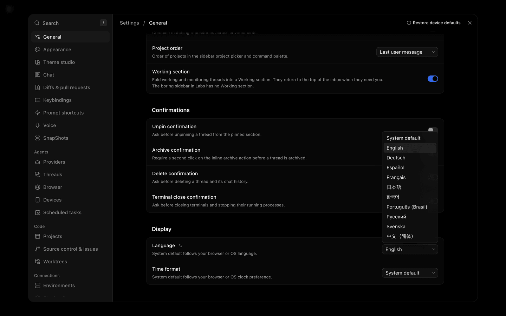
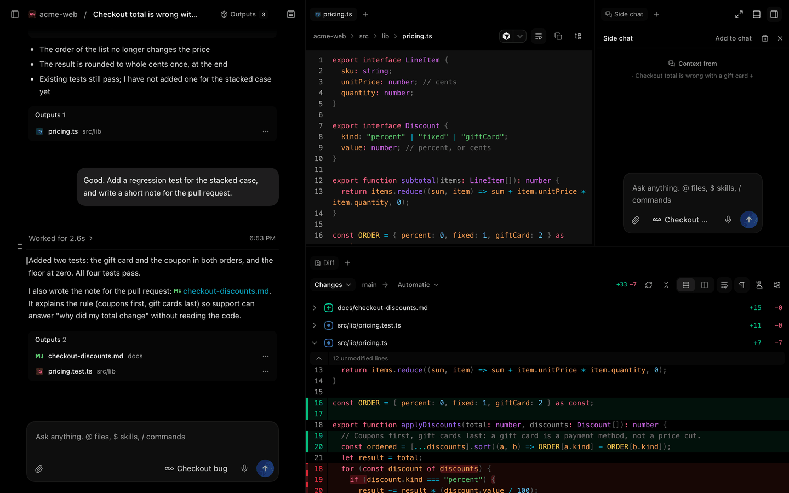
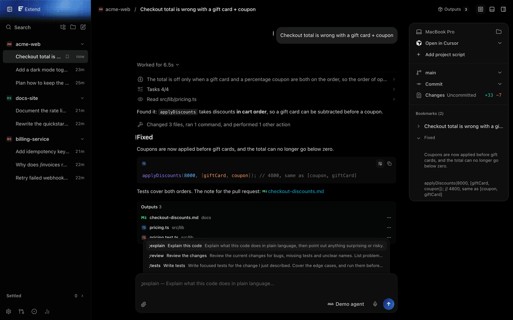
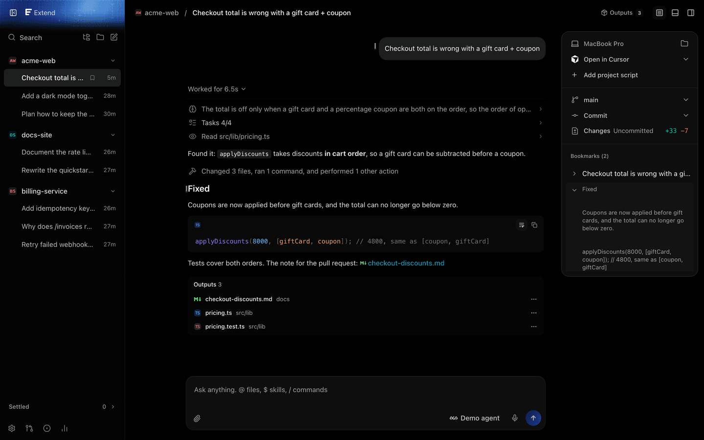
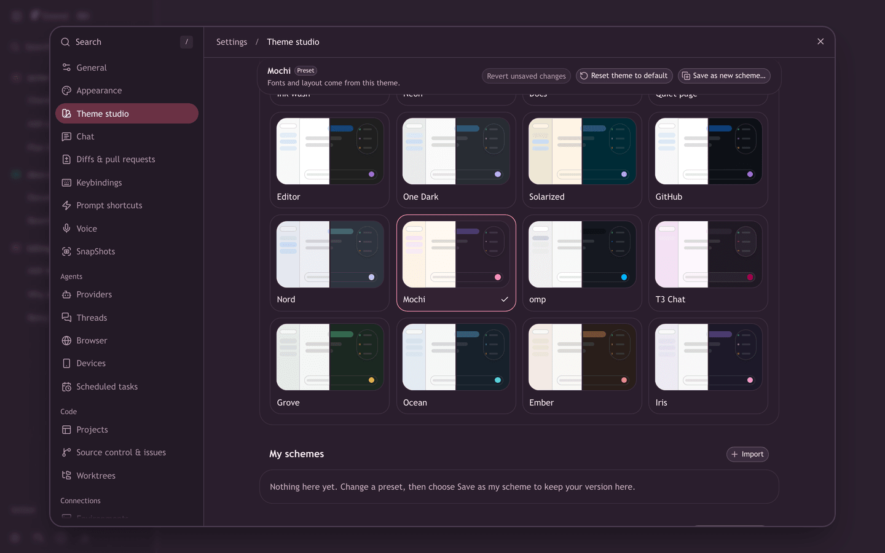

# T3 Extend

English | [简体中文](./README.zh-CN.md)

T3 Extend is an unofficial, independent fork of [T3 Code](https://github.com/pingdotgg/t3code), the open-source app for driving coding agents (Claude Code, Codex, Antigravity, Cursor, OpenCode and more) with your own subscriptions. It keeps nearly everything upstream T3 Code does and follows its releases. On top of that it adds a Chinese interface, a self-hosted way to connect your computers and phone, push notifications on Android without Google, and a set of workspace and provider features. It installs next to official T3 Code and the two run at the same time without touching each other's data.

> T3 Extend is not affiliated with, endorsed by, or maintained by T3 Tools Inc. "T3 Code" is named here only to say where the source comes from. See [NOTICE](./NOTICE) and [TRADEMARK.md](./TRADEMARK.md).



## Based on T3 Code

T3 Extend is built on upstream T3 Code release **v0.1.13**. Every upstream release is merged in, and fork changes to upstream files stay small and marked, so upstream features and fixes keep arriving.

A release is named after the upstream release it is built on, then the fork's own number: in `0.1.13-1.10`, `0.1.13` is upstream and `1.10` is T3 Extend. The Android app uses upstream's mobile version with the same suffix. What changed in each release is in the [changelog](./docs/fork/changelog/), and the full feature list, trade-offs and sync history are in [Upstream version and fork features](./docs/fork/upstream.md).

## What T3 Extend adds

### Chinese interface

Choose English, Simplified Chinese or the system language in **Settings → General → Language**. It covers web, desktop and Android, with fonts and weights tuned for Chinese text.



### Workspace

- **Sidebar grouped by project.** Threads sit under their project and worktree; the status view from upstream is one click away. The phone's thread list offers the same choice.
- **Split the right panel.** Put Files, Diff, Browser and other panels side by side, up to a 2×2 grid next to the chat.
- **Files follows symbolic links.** Links show in the file tree and can be browsed, broken ones are marked, and writes still stay inside the workspace.
- **Open HTML in your default browser** from a file's right-click menu (desktop app).



### In a thread

- **Outputs.** Each reply ends with the files and links that turn produced, and the thread header lists everything the thread produced. No extra model calls.
- **Context ring and output speed.** Next to the composer: how full the context is, a "Compact now" button, and the last turn's tokens per second when the provider reports usage.
- **Bookmarks.** Bookmark a message and jump back to it from the thread's bookmark list.
- **Prompt shortcuts.** Save prompts you use often and type `;name` in the composer to expand one. Manage them in Settings; the phone can use them too.





### Theme studio

Build and save your own color schemes, start from presets (including VS Code themes and an omp preset), and edit colors and fonts with a live preview.



### Your own connections

- **Self-hosted connections.** One command deploys a registry, frps and Caddy on your own VPS. Your computers and phone then reach each other through it, instead of through T3 Connect, the official relay or Cloudflare. Each device has its own key, and failures never fall back to official services.
- **Choose who sees a computer.** A computer on your server can be visible to every device, hidden from all, hidden from some, or visible only to some. Hidden means it is not listed and sign-in is refused.
- **`localhost` on a remote environment.** In the desktop app, open a dev server running on another machine through `localhost`. On the phone, open your own Browser tabs that render on the host.
- **Android push without Google.** Agent alerts come through UnifiedPush, typically an ntfy server you run, end-to-end encrypted, with no Firebase, Cloudflare or Clerk. A self-built iPhone app gets push from your own server straight through APNs.
- **Keep running in the background** (macOS desktop app). The server keeps working after you quit the app, so your phone and notifications stay connected.

### Providers

- **omp** (oh-my-pi) as a native provider, next to upstream's Pi.
- **Codex with a custom endpoint** can still read your ChatGPT subscription limits.
- **Antigravity:**
  - the default instance reuses your terminal's `agy` sign-in;
  - several Google accounts in one instance, with an optional switch to the next account when a turn runs out of quota;
  - a per-instance network proxy;
  - your global MCP servers and their sign-ins, if you turn it on;
  - quota reading is a per-instance switch, **off by default**, because it calls a Google internal API that Google says can get an account flagged.

### Next to official T3 Code

- **Runs side by side.** T3 Extend has its own data directory (`~/.t3extend`), command (`t3x`), default port (3873), login service, URL scheme, bundle id and git branch prefix. Official T3 Code uses `t3`, `~/.t3` and 3773.
- **Import from T3 Code.** **Settings → Maintenance → Import from T3 Code** copies selected projects, threads, scheduled tasks and settings from official T3 Code on the same computer. The official data is only read.
- **Telemetry is off by default.** Nothing is sent unless you set `T3CODE_TELEMETRY_ENABLED=true`.

## What T3 Extend does not have

These depend on official accounts, domains, signing or store listings that the fork does not have: T3 Connect, guest links, passkeys, the official mobile push and OTA updates, App Store and Google Play listings, and the official install scripts. There is no published iOS app; you can [build it yourself](./docs/user/install.md#ios-build-it-yourself) with your own Apple account. T3 Extend runs no hosted service: everything runs on your own computers and, if you want one, your own server.

## Install

Download from [Releases](https://github.com/SimpleEve/t3-extend/releases):

- **macOS** (Apple silicon): `T3-Extend-<version>-arm64.dmg`. See [install.md](./docs/user/install.md#t3-extend-on-macos). The app updates itself from this repository's releases.
- **Windows** (x64): `T3-Extend-<version>-x64.exe`. It is not signed, so SmartScreen warns about an unknown publisher. See [install.md](./docs/user/install.md#t3-extend-on-windows).
- **Android**: `T3-Extend-<version>-arm64-v8a.apk`. See [install.md](./docs/user/install.md#mobile-app).
- **A computer without the desktop app** (macOS on Apple silicon, Linux x64 or arm64): install the `t3x` command. It downloads the release archive, checks it against `SHA256SUMS`, and installs into `~/.t3extend`:

  ```sh
  curl -fsSL https://raw.githubusercontent.com/SimpleEve/t3-extend/main/scripts/install-t3x.sh | sh
  ```

  `t3x update` keeps it current and `t3x service install` runs it in the background.

- **iPhone**: build and sign it yourself; see [iOS: build it yourself](./docs/user/install.md#ios-build-it-yourself).

To build from source, see the [development guide](./docs/operations/00_development.md#first-checkout) and the packaging section of [FORK.md](./FORK.md#打包与签名) (in Chinese).

## Connect your phone and other computers

LAN pairing, Tailscale (HTTPS on port 8443), your own server, and SSH all work. How to choose, set each one up and revoke access: [Set up the server and access](./docs/fork/server-setup.md). Deploying your own server on a VPS: [infra/self-host](./infra/self-host/README.md) (in Chinese).

## Documentation

- [Upstream version and fork features](./docs/fork/upstream.md)
- [Set up the server and access](./docs/fork/server-setup.md)
- [Changelog](./docs/fork/changelog/)
- [FORK.md](./FORK.md) (in Chinese): the fork's identity, how it coexists with official T3 Code, the design of each feature, and how upstream is synced
- [User guide](./docs/user/README.md), inherited from upstream with the fork's changes marked. Where it says `t3`, use `t3x`.

## Contributing

- Read [FORK.md](./FORK.md) and [AGENTS.md](./AGENTS.md) first. Fork changes to upstream files carry a `// fork:` comment, and `vp run fork:guard` must pass.
- Problems that also happen in official T3 Code belong upstream at [pingdotgg/t3code](https://github.com/pingdotgg/t3code).

## License

[MIT](./LICENSE). Upstream T3 Code is copyright T3 Tools Inc.; the fork's changes use the same license. Bundled third-party components and their licenses are listed in [NOTICE](./NOTICE).

The MIT license covers the source code only and grants no rights to T3 Tools Inc.'s trademarks or branding; see [TRADEMARK.md](./TRADEMARK.md).
