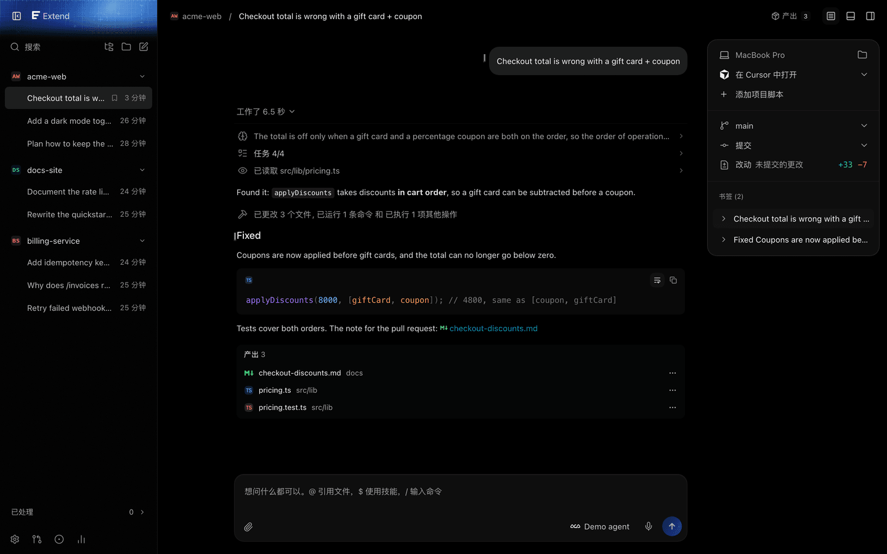
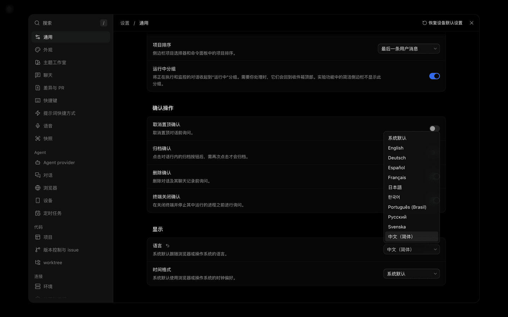
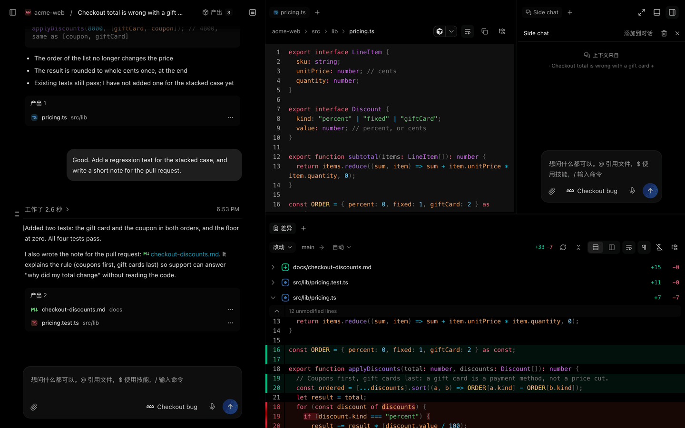
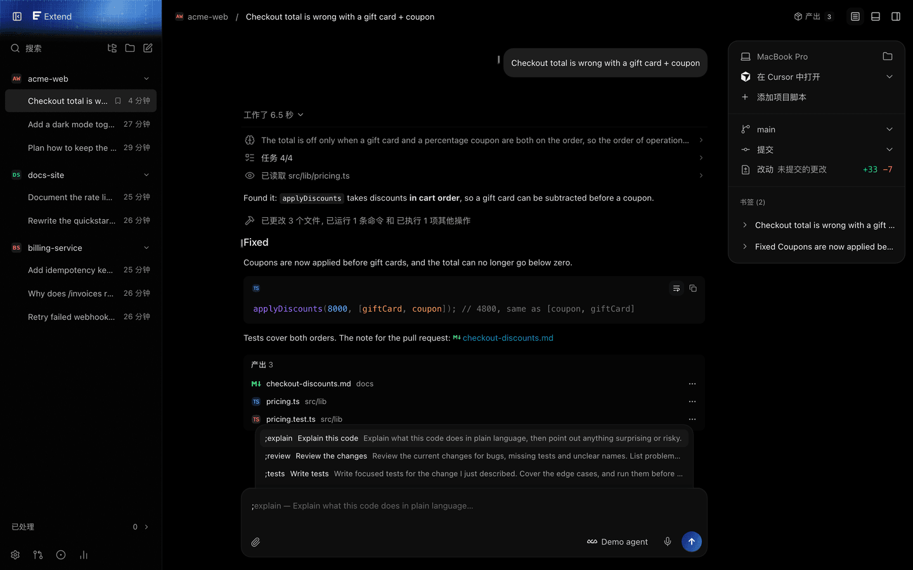
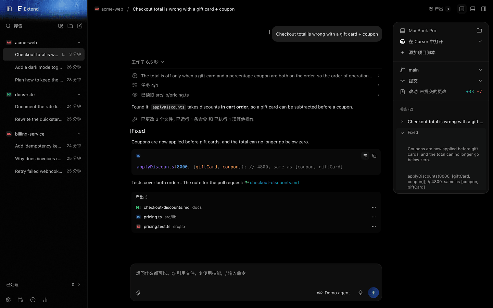
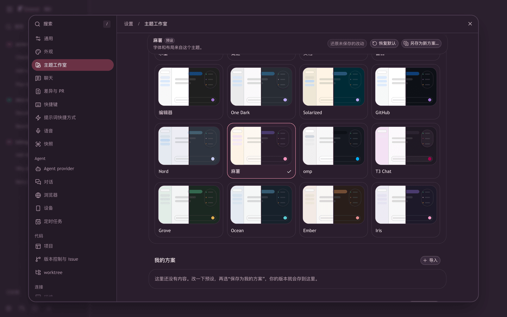

# T3 Extend

[English](./README.md) | 简体中文

T3 Extend 是 [T3 Code](https://github.com/pingdotgg/t3code) 的非官方独立 fork，也就是在 T3 Code 源码基础上的二次开发。T3 Code 是一个开源应用，用你自己的订阅来驱动编程 agent（Claude Code、Codex、Antigravity、Cursor、OpenCode 等）。T3 Extend 保留了上游几乎全部的能力，并持续跟进上游的正式版；在此之上加了中文界面、自建的电脑与手机互联方式、Android 上不依赖 Google 的推送，以及一批工作区和 provider 方面的功能。它可以和官方 T3 Code 装在同一台电脑上同时运行，两边的数据互不干扰。

> T3 Extend 与 T3 Tools Inc. 没有隶属、背书或维护关系。这里提到 "T3 Code" 只是为了说明源码的来源，见 [NOTICE](./NOTICE) 和 [TRADEMARK.md](./TRADEMARK.md)。



## 基于 T3 Code

T3 Extend 当前基于上游 T3 Code 正式版 **v0.1.13**。上游每个正式版都会合并进来；fork 对上游文件的改动尽量少，并且都做了标记，所以上游的新功能和修复会一直跟过来。

版本号由两段组成：前一段是所基于的上游版本，后一段是 T3 Extend 自己的版本号。比如 `0.1.13-1.10`，`0.1.13` 是上游的，`1.10` 是 T3 Extend 的。Android 应用用上游的移动端版本号加同一个后缀。每个版本改了什么见 [changelog](./docs/fork/changelog/)；完整的能力列表、取舍原因和同步历史见 [上游版本与 fork 能力](./docs/fork/upstream.zh-CN.md)。

## T3 Extend 额外加的

### 中文界面

在 **设置 → 通用 → 语言** 里选英文、简体中文或跟随系统。web、桌面和 Android 都支持，中文的字体和字重单独调过。



### 工作区

- **侧栏按项目分组。** 对话归在各自的项目和 worktree 下面，上游的按状态视图一键可切。手机的对话列表也可以这样选。
- **右侧面板分屏。** Files、Diff、Browser 等面板可以并排放在对话旁边，最多 2×2 四格。
- **Files 面板显示软链。** 文件树里能看到软链并进去浏览，断开的软链会标出来，写入仍然限制在工作区内。
- **用默认浏览器打开 HTML。** 桌面版里，在文件的右键菜单里选择。



### 对话里

- **产出。** 每轮回复末尾列出这一轮产出的文件和链接，对话头部可以看整个对话的产出。不额外调用模型。
- **上下文圆环和输出速度。** 输入框旁边显示上下文用了多少，可以"立即压缩"；provider 上报了用量时，还会显示上一轮每秒输出多少 token。
- **书签。** 给一条消息加书签，之后从对话的书签列表跳回去。
- **提示词快捷方式。** 把常用的提示词存下来，在输入框里输入 `;名字` 就会展开。在设置里管理，手机上也能用。





### 主题工作室

可以做自己的配色方案并保存，也可以从预设开始（包括 VS Code 主题和 omp 预设），改颜色和字体时实时预览。



### 自己掌控的连接

- **自建连接。** 一条命令在你自己的 VPS 上部署 registry、frps 和 Caddy，之后电脑和手机通过它互相连接，不经过 T3 Connect、官方 relay 和 Cloudflare。每台设备一把自己的密钥，连不上时也不会回落到官方服务。
- **决定谁能看到一台电脑。** 服务器上的每台电脑可以对所有设备可见、全部隐藏、对指定设备隐藏，或只对指定设备可见。隐藏的意思是不出现在列表里，登录也会被拒绝。
- **远程环境上的 `localhost`。** 在桌面版里，用 `localhost` 直接打开另一台机器上跑的开发服务；在手机上可以自己新建浏览器标签页，页面在宿主机上渲染。
- **Android 推送不依赖 Google。** Agent 提醒经 UnifiedPush 送达，通常配合你自己跑的 ntfy 服务器，载荷端到端加密，不经过 Firebase、Cloudflare 和 Clerk。自己构建的 iPhone 版由你自己的服务器直连 APNs 推送。
- **后台运行**（macOS 桌面版）。退出 app 之后服务继续运行，手机和推送不会断。

### Provider

- **omp**（oh-my-pi）作为原生 provider，和上游的 Pi 并存。
- **Codex 配了自定义端点**时，仍然可以读取 ChatGPT 订阅额度。
- **Antigravity：**
  - 默认实例直接沿用终端里 `agy` 的登录；
  - 一个实例里可以登录多个 Google 账号，可选在某一轮额度用完时自动切到下一个账号；
  - 每个实例可以单独设置网络代理；
  - 打开开关后，可以使用全局配置的 MCP 服务器和它们的登录；
  - 读取额度是每个实例的开关，**默认关闭**：读额度要调用 Google 的内部接口，Google 表示这可能导致账号被标记。

### 和官方 T3 Code 并存

- **可以同时运行。** T3 Extend 有自己的数据目录（`~/.t3extend`）、命令（`t3x`）、默认端口（3873）、开机服务、URL scheme、bundle id 和 git 分支前缀。官方 T3 Code 用的是 `t3`、`~/.t3` 和 3773。
- **从 T3 Code 导入。** **设置 → 维护 → 从 T3 Code 导入**，把本机官方 T3 Code 里选中的项目、对话、定时任务和设置带过来。官方的数据只读不改。
- **遥测默认关闭。** 只有设置了 `T3CODE_TELEMETRY_ENABLED=true` 才会上报。

## T3 Extend 里没有的

下面这些依赖官方的账号、域名、签名或应用商店，fork 没有：T3 Connect、guest link、passkey、官方的移动推送和 OTA 更新、App Store 和 Google Play 上架、官方安装脚本。iOS 没有发布安装包，可以用自己的 Apple 账号[自己构建](./docs/user/install.md#ios-build-it-yourself)。T3 Extend 不运营任何托管服务，一切都跑在你自己的电脑上，需要的话再加一台你自己的服务器。

## 安装

到 [Releases](https://github.com/SimpleEve/t3-extend/releases) 下载：

- **macOS**（Apple silicon）：`T3-Extend-<version>-arm64.dmg`，见 [install.md](./docs/user/install.md#t3-extend-on-macos)。app 会从本仓库的 Releases 自动更新。
- **Windows**（x64）：`T3-Extend-<version>-x64.exe`。安装包没有签名，SmartScreen 会提示"未知发布者"，见 [install.md](./docs/user/install.md#t3-extend-on-windows)。
- **Android**：`T3-Extend-<version>-arm64-v8a.apk`，见 [install.md](./docs/user/install.md#mobile-app)。
- **没装桌面版的电脑**（Apple silicon 的 macOS，Linux x64 或 arm64）：安装 `t3x` 命令。它会下载 release 归档，按 `SHA256SUMS` 校验，装进 `~/.t3extend`：

  ```sh
  curl -fsSL https://raw.githubusercontent.com/SimpleEve/t3-extend/main/scripts/install-t3x.sh | sh
  ```

  之后用 `t3x update` 更新，用 `t3x service install` 让它在后台运行。

- **iPhone**：需要自己构建和签名，见 [iOS：自己构建](./docs/user/install.md#ios-build-it-yourself)。

想从源码构建，见 [开发指南](./docs/operations/00_development.md#first-checkout) 和 [FORK.md](./FORK.md#打包与签名) 里的打包一节。

## 连接手机和其他电脑

支持局域网配对、Tailscale（HTTPS，端口 8443）、自建服务器和 SSH。怎么选、每种怎么设置、怎么撤销访问，见 [搭建 server 与配置访问](./docs/fork/server-setup.zh-CN.md)。在 VPS 上部署自建服务器，见 [infra/self-host](./infra/self-host/README.md)。

## 文档

- [上游版本与 fork 能力](./docs/fork/upstream.zh-CN.md)
- [搭建 server 与配置访问](./docs/fork/server-setup.zh-CN.md)
- [Changelog](./docs/fork/changelog/)
- [FORK.md](./FORK.md)：fork 的身份、和官方 T3 Code 怎么共存、每个功能的设计，以及怎么同步上游
- [用户文档](./docs/user/README.md)（英文）：继承自上游，fork 改动的地方有标注。文中写 `t3` 的地方，在 T3 Extend 里用 `t3x`。

## 参与开发

- 先读 [FORK.md](./FORK.md) 和 [AGENTS.md](./AGENTS.md)。fork 改动上游文件的行都带 `// fork:` 注释，提交前 `vp run fork:guard` 必须通过。
- 在官方 T3 Code 里也能复现的问题，请报到上游 [pingdotgg/t3code](https://github.com/pingdotgg/t3code)。

## 许可

[MIT](./LICENSE)。上游 T3 Code 的版权属于 T3 Tools Inc.，fork 的改动使用同样的许可。随构建附带的第三方组件及其许可见 [NOTICE](./NOTICE)。

MIT 许可只覆盖源代码，不授予 T3 Tools Inc. 商标或品牌的任何权利，见 [TRADEMARK.md](./TRADEMARK.md)。
